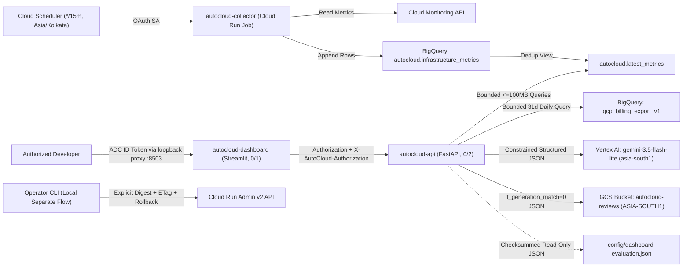

# AutoCloud AI — Final Semester-End Project Report

**Date:** 16 November 2026  
**GCP Project / Region:** `astute-sign-506809-j8` / `asia-south1` (Mumbai)  
**Latest Verified Release:** `data/releases/20261116T122601Z/` (`autocloud-api-00009-r79`, `autocloud-dashboard-00008-2vx`)

---

## 1. Executive Summary

**AutoCloud AI** is a private, evidence-bound observability, forecasting, cost-analysis, and human-in-the-loop operations assistant for Google Cloud Run workloads. Rather than granting autonomous scaling privileges to uncalibrated models or LLMs, the architecture enforces strict separation between telemetry ingestion, offline ML evaluation, deterministic policy guardrails, constrained Vertex AI Gemini prioritization, cryptographic service authentication, and operator-controlled Cloud Run mutations.

Key engineering outcomes achieved and verified against real GCP infrastructure:
- **Private Cloud Deployment & Least-Privilege IAM:** Separate Cloud Run services (`autocloud-api`, `autocloud-dashboard`) and a scheduled Cloud Run Job (`autocloud-collector`) running under distinct, zero-key service accounts with scoped permissions and unauthenticated HTTP `403` enforcement.
- **Honest Offline ML Findings:** On a measured 232-minute experiment cohort (`2,097` HTTP requests), all nine XGBoost candidate forecasts performed worse than or tied last-value persistence on held-out MAE (`0 / 9`, though `5 / 9` beat the training historical average), and Isolation Forest achieved `F1 = 0.9756` (`47` rows) / `1.0000` (`41` mutually observable rows) on post-hoc regime-shift labels while incurring a `42.55%` (`20/47`) false-positive rate across all `47` assumed-normal test minutes (with an idle-only false-positive rate of `20/21 = 95.24%` on idle/scale-to-zero minutes vs. `0/26 = 0.00%` during active traffic). Because our readiness and evaluation gates caught these generalization limits, experimental models remain `offline_candidate_not_deployed`.
- **Reproducible Mechanics Benchmark:** An executable deterministic 1,800-minute (`conservative`) synthetic benchmark (`python -m app.models.benchmark`) achieved `9 / 9` wins over both baselines on periodic dynamics, verifying the pipeline code without overclaiming real-world accuracy.
- **Constrained LangGraph + Vertex AI Gemini (`gemini-3.5-flash-lite`):** Live-verified in `asia-south1`; Gemini can only rank and assign validated summary codes to deterministically verified threshold candidates (`execution_allowed=false` everywhere; zero free-form numeric claims accepted).
- **Hardened Audit & Human-Reviewed Persistence:** Regional Cloud Storage (`astute-sign-506809-j8-autocloud-reviews`) with `if_generation_match=0` immutability, dual-header cryptographic OIDC verification (`X-AutoCloud-Authorization`), explicit service vs. self-reported human label tracking, merged `by_time/` + legacy `items/` top-200 reads, retry index repair, and enforced `30s` call/retry budget (`autocloud-api-00009-r79`).
- **Cost & Control-Plane Verification:** Live operator scaling trial (`min_instances` `0 -> 1 -> 0` in 15 seconds) verified configuration/etag/rollback safety, while `CostAnalyser` quantified counterfactual Tier-1 USD list-rate tradeoffs (`USD 0.3377388` vs. `USD 0.0159888` per 24h) alongside verified empty BigQuery Billing export handling (`no_exported_rows` = unknown spend, not zero).

---

## 2. System Architecture & Trust Boundaries

### Runtime Identities & Least-Privilege Scope

| Service Account | Attached Resource | Granted Roles / Permissions | Disallowed Actions |
| --- | --- | --- | --- |
| `autocloud-collector@...` | Cloud Run Job `autocloud-collector` | Monitoring Viewer (project), BigQuery Job User (project), BigQuery Data Editor (`autocloud.infrastructure_metrics` only) | No Cloud Run mutation, no Billing read, no Vertex AI access |
| `autocloud-scheduler@...` | Cloud Scheduler `autocloud-collect` | Cloud Run Invoker (`autocloud-collector` job only) | No BigQuery, Storage, or API access |
| `autocloud-api-reader@...` | Cloud Run `autocloud-api` | BigQuery Job User (project), `autocloud` dataset READER, Billing table Data Viewer (exact table), custom role `autocloudGeminiPredict` (`aiplatform.endpoints.predict` only), GCS `legacyBucketReader` / `objectCreator` / `objectViewer` on `autocloud-reviews` only | No Owner/Editor, no Cloud Run mutation/scaling, no delete permission on GCS reviews |
| `autocloud-dashboard@...` | Cloud Run `autocloud-dashboard` | Cloud Run Invoker (`autocloud-api` service only) | No direct BigQuery, GCS, Vertex AI, or Cloud Run Admin access |

---

## 3. Data Pipeline & ML Methodology Results

### 3.1 Ingestion & Readiness Gates (`app/data/`, `app/models/dataset.py`)
- Minute-aligned UTC grids (`regularize_history`) deduplicate by `(project_id, region, service_name)` and latest `collected_at`.
- **Missing measurements remain `NaN`/`null`** and are never coerced to zero before evaluation.
- Chronological splits (`60%` train / `20%` validation / `20%` test) purge boundary rows within horizon `H` (`5, 10, 15` minutes) to prevent future-label leakage.
- Two readiness profiles exist: `exploratory` (`>= 200` observed minutes, `<= 20%` feature missingness, `>= 100/20/20` measured split labels, marked `deployment_ready=false`) and `conservative` (`>= 1,440` observed minutes).

### 3.2 Held-Out Forecasting Results (`models/runs/20261116T051914Z_48d41482`)
Trained offline on the 232-minute controlled experiment cohort (`2026-11-15T18:09Z..22:00Z`, `2,097` HTTP requests, max feature missingness `9.05%`):

| Target | Horizon | Test Samples | XGBoost MAE | Persistence MAE | Historical Avg MAE | Result |
| --- | --- | --- | --- | --- | --- | --- |
| `cpu_utilization` | 5m | 36 | `0.000257` | `0.000153` | `0.000262` | Loses to persistence; beats hist avg |
| `cpu_utilization` | 10m | 31 | `0.000303` | `0.000142` | `0.000273` | Loses to both |
| `cpu_utilization` | 15m | 26 | `0.000309` | `0.000158` | `0.000288` | Loses to both |
| `memory_utilization` | 5m | 36 | `0.000023` | `~0.000000` | `0.000023` | Loses to persistence |
| `memory_utilization` | 10m | 31 | `0.000019` | `~0.000000` | `0.000019` | Beats hist avg only |
| `memory_utilization` | 15m | 26 | `0.000016` | `~0.000000` | `0.000016` | Beats hist avg only |
| `request_count` | 5m | 41 | `4.7951` | `1.2195` | `4.8728` | Active MAE `0.1960` vs HA `0.7836`; loses overall |
| `request_count` | 10m | 36 | `5.3632` | `2.7778` | `5.4546` | Beats hist avg only |
| `request_count` | 15m | 31 | `9.8740` | `4.8387` | `6.2672` | Loses to both |

**Diagnostic explanation (`forecast_diagnostics`):** The 3.87-hour cohort spans less than one diurnal cycle (`time_sin`/`time_cos` cannot learn daily periodicity), the active test segment (`21:14Z..21:39Z`) was piecewise-constant (`10 req/min`, flat `11.13%` memory -> persistence `0.0` MAE), and post-cutoff traffic cessation (`21:40Z..22:00Z`) triggered a step-to-zero shift that penalized fixed-horizon tree extrapolation.

**Controlled 1,800-minute Synthetic Benchmark (`app/models/benchmark.py`):** Reproducible via `.venv\Scripts\python.exe -m app.models.benchmark` (`seed=42`, `dataset_sha256: da1b193e0a013311b13ec87ec25c2f8e0c35eb75373349233a4844dfc07c3a36`, `conservative` profile covering `1.25` daily cycles and `62.8m`–`251.3m` harmonic periods). Under smooth periodic dynamics, `ResourcePredictor` beat both Persistence (**9 / 9**) and Historical Average (**9 / 9**), verifying implementation mechanics while remaining explicitly separated (`deployment_allowed=false`) from the `0 / 9` real-data outcome.

### 3.3 Held-Out Anomaly Detection Evaluation (Post-Hoc Experiment-Event Labels)
Without refitting `anomaly_detector.joblib`, the 47-minute test partition (`21:14Z..22:00Z`) was scored against external runner logs (`traffic_ended_at = 2026-11-15T21:38:59.189151+00:00`, 300/300 HTTP 200):

| Evaluation Set | Cohort | Detector | Matrix `[[TN, FP], [FN, TP]]` | Precision / Recall / F1 | FPR |
| --- | --- | --- | --- | --- | --- |
| Regime Shift (`anomaly_labels_regime_shift.csv`) | All 47 test rows | Isolation Forest | `[[26, 0], [1, 20]]` | `1.0000 / 0.9524 / 0.9756` | `0.0000` |
| Regime Shift (`anomaly_labels_regime_shift.csv`) | 41 observable rows (`6` abstentions) | Threshold Baseline | `[[26, 0], [15, 0]]` | `0.0000 / 0.0000 / 0.0000` | `0.0000` |
| Regime Shift (`shared_observable_comparison`) | 41 mutually observable rows | Isolation Forest | `[[26, 0], [0, 15]]` | `1.0000 / 1.0000 / 1.0000` | `0.0000` |
| Operational-Normality Audit (`anomaly_labels_operational_fault.csv`, `0` fault cases; fault sensitivity unmeasured) | All 47 test rows | Isolation Forest | `[[27, 20], [0, 0]]` | `0.0000 / 0.0000 / 0.0000` | **`0.4255`** (`20/47` all; **`95.24%`** = `20/21` idle-only; `0/26` active) |
| Operational-Normality Audit (`shared_observable_comparison`) | 41 mutually observable rows | Isolation Forest | `[[26, 15], [0, 0]]` | `0.0000 / 0.0000 / 0.0000` | **`0.3659`** (`15/41` all; `15/15` observable idle) |

**Conclusion:** Isolation Forest detects out-of-distribution regime shifts accurately (`F1 = 0.9756`–`1.0000`), but flags `42.55%` (`20/47`) of all `47` assumed-normal minutes — and **`20/21 = 95.24%`** of idle/scale-to-zero minutes alone — as anomalies when trained solely on active traffic, while fault recall remains unmeasured because `positive_fault_examples = 0`. Live anomaly inference stays disabled.

---

## 4. LangGraph + Vertex AI, Security Hardening & Human Review Workflow

- **Acyclic LangGraph Orchestration (`app/agents/orchestrator.py`):** Evaluates monitoring evidence (`build_plan`), model readiness, and optional billing inputs before routing fresh-breach catalogs to `gemini-3.5-flash-lite` (`asia-south1`, `256` max output tokens, `thinking_level=MINIMAL`, 1 attempt, 30s timeout).
- **Constrained Output Contracts (`app/agents/contracts.py`, `app/agents/validation.py`):** Gemini selects only a validated `summary_code` and ordering of existing catalog actions; all displayed text renders from `EXPLANATIONS` templates and original `Evidence` values, with `execution_allowed=false`.
- **Cryptographic OIDC Verification & Review Attribution (`app/api/reviews.py`, `app/dashboard/authentication.py`):**
  - `api_headers` sends `Authorization` (Cloud Run edge IAM) and intact `X-AutoCloud-Authorization` (preserving the RS256 signature past Google Front End).
  - `verify_oidc_principal` rejects `.SIGNATURE_REMOVED_BY_GOOGLE`, generic SDK audiences, and mixed `X-Serverless-Authorization` spoofing, enforcing strict `aud == DASHBOARD_REVIEW_AUDIENCE`.
  - Records `calling_service_principal` alongside `reviewer_identity="service_authenticated_self_reported_label"` (`human_reviewer_verified=false`) so service authentication is never misrepresented as multi-user human SSO.
- **Immutable Bounded GCS Storage (`app/services/review_store.py`):** Uses `if_generation_match=0`, `by_time/` reverse-microsecond indexing bounded to `<= 200` indexed item downloads and `<= 200` decision lookups, capture-retry index repair, merged indexed + unindexed legacy `items/` top-200 selection, single-use `HTTPIterator.pages` handling, and an overall `30.0s` storage/retry budget across calls and SDK retries (deployed and live-verified in release `20261116T122601Z`).

---

## 5. Cost Analysis & Operator Control-Plane Verification

- **Live Billing Export Verification (`2026-11-16T11:28:52Z`):** `GET /api/costs?days=7`, `GET /api/costs?days=31`, a direct 31-day BigQuery diagnostic query on `autocloud_billing.gcp_billing_export_v1_011640_0793FF_B5C560`, and the live Streamlit WebSocket **`Read billing export`** control all confirmed `status="no_exported_rows"` (`0` rows across all services so far). Actual spend remains **unknown, not zero**.
- **Verified Operator Scaling Trial (`live_result.json`):** Executed `autocloud-api` `min_instances` `0 -> 1 -> 0` between `05:31:23Z` and `05:31:38Z` with digest/etag/drift verification and full restoration (`generation 3`, `Ready: CONDITION_SUCCEEDED`).
- **`CostAnalyser` Counterfactual List-Rate Models (`asia-south1`, USD, excluding free-tier credits):**
  - **232m experiment assumption (`2,097` requests, `600s` CPU / `300s` GiB):** `USD 0.0159888` (`illustrative_estimate`).
  - **24h counterfactual (`min_instances=1` vs. `min_instances=0`):** `USD 0.3377388` (including `85,800s` warm idle cost) vs. `USD 0.0159888` (`estimated_savings = USD 0.3217500`, `~95.27%`, marked `counterfactual_estimate_not_measured`, `measured_savings=null`).
  - **Scheduled `autocloud-collector` Job (`96` cron runs/day at 1-min minimum):** `USD 0.1094400 / day`.

---

## 6. Verification & Compliance Summary

- **Automated Test Suite & Dependencies:** `227 passed` in the full offline pytest suite (`pip check` reported zero broken requirements; `compileall -q app tests` succeeded), including regression coverage for `>200` unindexed legacy records, `480`-record mixed legacy/indexed merging, single-use `HTTPIterator.pages` pagination (plus direct real-bucket read-only verification), retry index repair, and overall `30.0s` budget enforcement across calls and SDK retries.
- **Live Cloud State & Deployed Release `20261116T122601Z`:** Staged rollout of `@sha256:bea5a49ccf99ce8a87b118599744b39aea28a3f4fadf2bbaad5462acc2f84f24` (Cloud Build `274772cf-2620-4615-a171-36f9cbea3008`) passed both stages (`autocloud-api-00009-r79` `generation 11` and `autocloud-dashboard-00008-2vx` `generation 8`): unauthenticated `403`s across all routes, `R1` negative security rejections (`401`/`403`), `/api/reviews` HTTP `200` (`0.36s` Stage 1 / `0.17s` Stage 2 in Cloud Run logs), and positive Streamlit WebSocket **`Load review history`** confirmation with zero `ERROR` alerts (`overall_passed: true`, `history_loaded_confirmed: true`). Read-only collector checks confirmed `12/12` cron successes and `3m28s`–`18m35s` active cycle lag.
- **Gaps / Next Steps for Operational Production Use:** Multi-day representative Cloud Run traffic spanning >=24h to satisfy `conservative` (`1,440` min) gates; true injected fault examples to measure fault sensitivity alongside idle behavior; delayed Cloud Billing export ingestion reconciliation + authorized before/after latency/cost experiments; end-user IAP/OIDC identity if individual human audit attribution is required.
